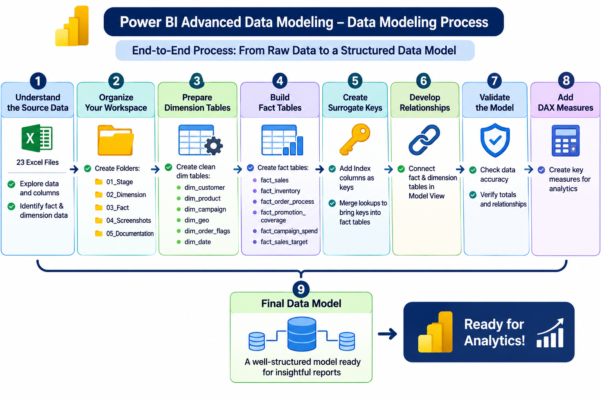
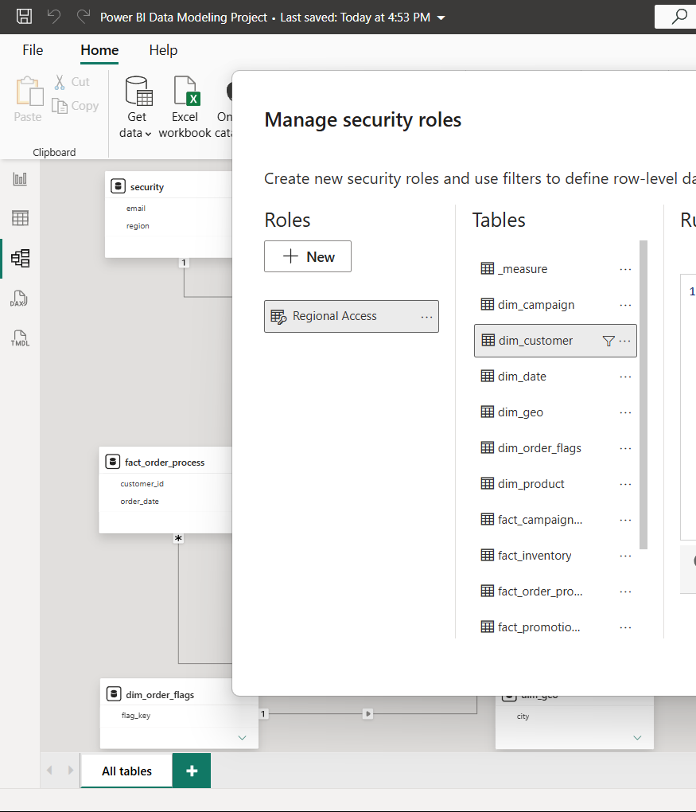
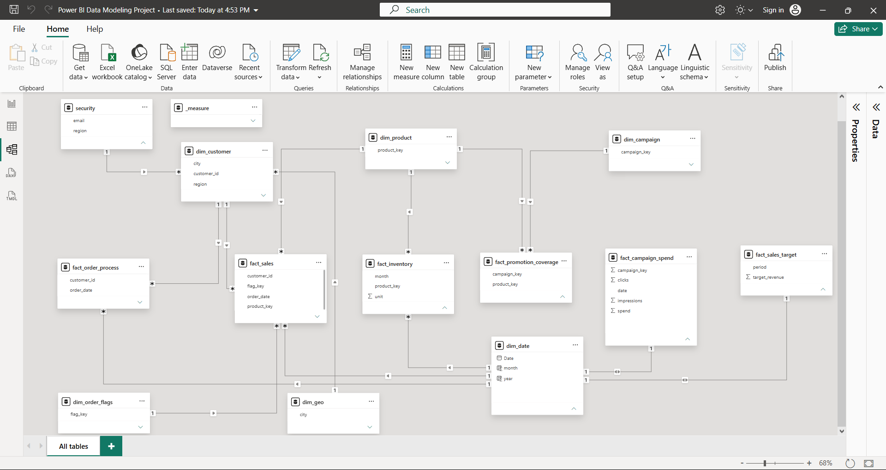

# Power BI Advanced Data Modeling Project

## 📌 Project Overview

This project focuses on building an organised and structured data model using **Microsoft Power BI**.

The objective was to transform multiple sheets of source business data into a well-structured model containing fact tables, dimension tables, and supporting tables.

The project follows an end-to-end data modeling process using Power Query for data preparation, surrogate keys for identifying dimension records, and relationships to connect different business processes.

The final model supports analysis across sales, customers, products, inventory, marketing campaigns, promotions, order processing, and sales targets.

---

## 🎯 Project Objectives

- Understand and explore the source datasets.
- Organise and prepare queries using Power Query.
- Develop fact and dimension tables.
- Create surrogate keys using index columns.
- Integrate dimension keys into fact tables.
- Establish relationships between tables.
- Identify and resolve data-quality issues.
- Implement Row-Level Security (RLS) for regional data access.
- Develop a structured Power BI data model.

---

## 🛠️ Tools and Technologies

| Tool / Technology | Purpose |
|---|---|
| Microsoft Power BI Desktop | Data modeling and business intelligence |
| Power Query | Data cleaning and transformation |
| DAX | Analytical calculations and measures |
| Microsoft Excel | Source data |

---

## 🔄 Project Workflow

The project was completed through the following stages:

1. Understanding the source data.
2. Organising queries and preparing the workspace.
3. Developing dimension tables.
4. Developing fact tables.
5. Creating surrogate keys.
6. Integrating tables using merge and lookup operations.
7. Establishing relationships.
8. Validating the data model.
9. Organising analytical measures.
10. Implementing and testing Row-Level Security.

## Data Modeling Process



---

## 🗂️ Final Data Model Structure

The final Power BI model contains **14 tables**.

### 1. Dimension Tables

Dimension tables contain descriptive information used to analyse business data.

| Table | Description |
|---|---|
| `dim_customer` | Customer information |
| `dim_product` | Product details |
| `dim_campaign` | Marketing campaign information |
| `dim_geo` | Geographic information |
| `dim_order_flags` | Order-related attributes |
| `dim_date` | Date, month, and year information |

### 2. Fact Tables

Fact tables contain business events and measurable information.

| Table | Description |
|---|---|
| `fact_sales` | Sales transaction information |
| `fact_inventory` | Product inventory information |
| `fact_order_process` | Order processing and delivery dates |
| `fact_promotion_coverage` | Campaign and product coverage |
| `fact_campaign_spend` | Campaign spending and performance |
| `fact_sales_target` | Sales target information |

### 3. Supporting Tables

| Table | Description |
|---|---|
| `security` | User email addresses and assigned regions for RLS |
| `_measure` | Organises analytical measures |

### Model Summary

| Category | Number of Tables |
|---|---:|
| Dimension Tables | 6 |
| Fact Tables | 6 |
| Supporting Tables | 2 |
| **Total** | **14** |

---

## 🔧 Power Query Transformations

The following transformations were used during data preparation and table development:

- Merge Queries
- Expand Columns
- Remove Columns
- Rename Columns
- Change Data Types
- Remove Duplicates
- Add Index Columns
- Filter Rows
- Split Columns
- Trim Text
- Unpivot Columns
- Reorder Columns

These transformations helped prepare the source data for the final model.

---

## 🔑 Data Modeling Concepts

The project provided practical experience with:

- Fact and dimension table design
- Dimensional modeling
- Surrogate key creation
- Merge and lookup operations
- One-to-many relationships
- Relationship cardinality
- Data integration
- Data-quality validation
- Multiple fact tables
- Analytical measure organisation
- Row-Level Security

---

## 🔐 Row-Level Security (RLS)

Row-Level Security (RLS) was implemented and tested to control data access based on geographical regions.

### Security Implementation

- Created a separate `security` table containing user email addresses and their assigned regions.
- Created a security role named `Regional Access`.
- Configured regional filtering on the `dim_customer` table.
- Tested the security role to verify the regional data access.

### Security Table

The security table contains five users, each assigned to a specific geographical region.

| Email | Region |
|---|---|
| nora.adel@arka.com | North America |
| hans.weber@arka.com | Europe |
| kenji.sato@arka.com | Asia Pacific |
| diego.ramos@arka.com | Latin America |
| omar.farouk@arka.com | Middle East |

### Business Purpose

In an organisation, employees working in different geographical regions may need access only to their respective regional data.

For example, a North America employee should be able to view North America customer data, while a Europe employee should be able to view Europe customer data.

RLS helps restrict data visibility based on user permissions and provides controlled access to business information.

### RLS Configuration



---

## 📊 Final Data Model

The final model connects different business processes through fact and dimension tables.

It provides a structured foundation for analysing:

- Sales performance
- Customer information
- Product performance
- Inventory levels
- Campaign spending
- Promotion coverage
- Order processing
- Sales targets



---

## 📁 Repository Structure

```text
Power-BI-Advanced-Data-Modeling/
│
├── Dataset/
│   ├── PowerBI_Source_Data.xlsx
│   └── README.md
│
├── Documentation/
│   └── Project_Process.md
│
├── Screenshots/
│   ├── README.md
│   ├── 01_Complete_Data_Model.png
│   ├── 02_Data_Modeling_Process.png
│   └── 03_Row_Level_Security.png
│
├── PowerBI/
│   └── PowerBI_Data_Modeling.pbix
│
└── README.md
```

---

## 📚 Documentation

For a detailed explanation of the project stages, transformations, and modeling approach, refer to:

- [Complete Project Process](Documentation/Project_Process.md)
- [Dataset Information](Dataset/README.md)

---

## 🎓 Key Learnings

Through this project, I gained practical experience in:

- Understanding complex source datasets.
- Preparing data using Power Query.
- Designing fact and dimension tables.
- Creating surrogate keys.
- Integrating tables through merge and lookup operations.
- Handling duplicate records and data-quality issues.
- Building relationships in Power BI Model View.
- Organising a multi-fact data model.
- Implementing and testing Row-Level Security.
- Understanding regional data access control.

---

**Project:** Power BI Advanced Data Modeling  
**Tool:** Microsoft Power BI Desktop  
**Focus:** Data Preparation | Dimensional Modeling | Fact & Dimension Tables | Data Relationships | Row-Level Security
